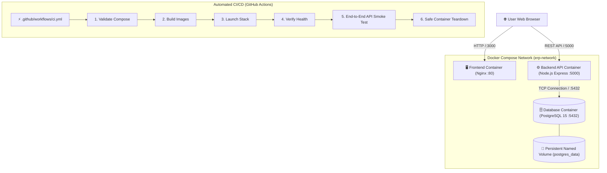

# 🏆 ERP DevOps Arena — Tournament Challenge

[](https://www.docker.com/)
[](https://docs.docker.com/compose/)
[](https://github.com/features/actions)
[](https://www.postgresql.org/)
[](https://nodejs.org/)
[](https://nginx.org/)

Welcome to the **ERP DevOps Arena** tournament challenge! This competition evaluates hands-on DevOps engineering, container orchestration, Linux systems troubleshooting, reliability engineering, and CI/CD automation.

---

> [!CAUTION]
> ## ⚠️ AI-Assisted Development and Disqualification Policy
> 
> **This tournament evaluates participants' individual DevOps engineering capability, problem-solving skills, and technical understanding.**
>
> - **Independent Work Requirement**: Participants must complete all challenge tasks, Docker configurations, troubleshooting, and GitHub Actions workflows independently.
> - **Prohibition of AI Generation**: AI coding assistants and AI agents (including but not limited to **Claude, ChatGPT, GitHub Copilot, Cursor, Antigravity**, and similar autonomous tools) are **strictly prohibited** from modifying, generating, committing, or contributing code, configuration files, workflows, or other repository contents for tournament submissions.
> - **Prohibition of AI Commits**: Participants must not allow AI agents or automated bots to make commits, push changes, or autonomously modify their repositories.
> - **Audit & Verification**: Tournament judges and organizers will inspect GitHub contribution records, commit history, author signatures, commit timestamps, and repository activity during the evaluation process.
> - **Immediate Disqualification**: **Any confirmed use of prohibited AI-assisted development or automated AI-agent contributions—including contributions appearing under AI-associated identities or bot accounts in the GitHub contributors list—will result in immediate disqualification.**
> - **Participant Accountability**: Participants are solely responsible for ensuring that their submitted repository strictly complies with this integrity policy.

---

## 📖 Table of Contents

1. [Challenge Overview](#-challenge-overview)
2. [Application Architecture](#-application-architecture)
3. [Technology Stack](#-technology-stack)
4. [Prerequisites & Verification](#-prerequisites--verification)
5. [Getting Started & Repository Cloning](#-getting-started--repository-cloning)
6. [Challenge Tasks & Requirements](#-challenge-tasks--requirements)
   - [Task 1: Docker Containerization](#task-1--docker-containerization)
   - [Task 2: Docker Compose Deployment](#task-2--docker-compose-deployment)
   - [Task 3: Infrastructure Troubleshooting](#task-3--infrastructure-troubleshooting)
   - [Task 4: Reliability & Security Hardening](#task-4--reliability--security-hardening)
   - [Task 5: GitHub Actions CI Pipeline](#task-5--github-actions-ci-pipeline)
   - [Task 6: Advanced Bonus Tasks (Optional)](#task-6--advanced-bonus-tasks-optional)
7. [Recommended Workflow](#-recommended-workflow)
8. [Docker Commands Cheat Sheet](#-docker-commands-cheat-sheet)
9. [Troubleshooting Guide](#-troubleshooting-guide)
10. [Submission Guidelines](#-submission-guidelines)
11. [Competition Rules](#-competition-rules)
12. [Evaluation Rubric (100 Points)](#-evaluation-rubric-100-points)

---

## 🎯 Challenge Overview

### Scenario
You are a Senior DevOps Engineer onboarded to deploy **VOLTEX**, an enterprise 3-tier Electronic Parts Distribution & Wholesaling ERP application. The software engineering team has handed over the core application codebase, but the deployment setup is **incomplete, partially misconfigured, and lacking automated testing**.

### Objective
Your mission is to transform this starter repository into a robust, secure, production-grade deployment:
1. Fix and optimize the **Dockerfiles** for both frontend and backend.
2. Troubleshoot and resolve the intentional infrastructure defects in **Docker Compose**.
3. Establish robust **health checks, persistent volumes, and networking**.
4. Construct an automated **GitHub Actions CI/CD pipeline** from scratch.
5. Demonstrate that the full stack runs seamlessly locally and passes CI verification.

```bash
# Expected end-state command:
docker compose up -d --build
```

---

## 🏛 Application Architecture

The VOLTEX ERP system consists of three distinct tiers operating within an internal Docker network:



### Architectural Breakdown
- **Presentation Tier (Frontend)**:
  Single-Page Application (SPA) built with React 18, Tailwind CSS, and FontAwesome with real-time backend synchronization. Packaged via multi-stage Docker build and served via an optimized `nginx:1.25-alpine` container.
- **Application Tier (Backend API)**:
  Secure Node.js (v18 Alpine) REST API built on Express, secured with Helmet, dynamic CORS validation, and rate limiting. Connects to PostgreSQL using a connection pool (`pg`). Exposes a `/health` endpoint and `/api` business endpoints.
- **Data Tier (PostgreSQL)**:
  PostgreSQL 15 Alpine storing parts inventory and customer order records. Seeded on first run via `/docker-entrypoint-initdb.d/init.sql`. Requires persistent storage for data durability.
- **Network Isolation & Host Access**:
  Services communicate internally across Docker's bridge network. Ports must be selectively exposed to the host machine for browser access and API consumption.

---

## 🛠 Technology Stack

| Component | Technology | Version / Base Image | Purpose |
| :--- | :--- | :--- | :--- |
| **Frontend** | React 18 / Tailwind CSS | `nginx:1.25-alpine` | Web UI & Static Asset Serving |
| **Backend API** | Node.js / Express.js | `node:18-alpine` | REST API, Business Logic & DB Pool |
| **Database** | PostgreSQL | `postgres:15-alpine` | Relational Data Store & Seed Schema |
| **Orchestration** | Docker Compose | Compose Specification v2+ | Multi-Container Local Deployment |
| **Automation** | GitHub Actions | Ubuntu Latest Runners | Continuous Integration & Validation |
| **Security** | Helmet / Least Privilege | Non-root `node` execution | Container Hardening & Access Control |

---

## 📋 Prerequisites & Verification

Ensure you have the following tools installed on your local workstation:

1. **Git** (v2.30+)
2. **Docker Engine** (v24.0+) or **Docker Desktop** (v4.20+)
3. **Docker Compose** (v2.20+)
4. **GitHub Account** (with public repository hosting rights)

### Verify Installations
Run these verification commands in your terminal:

```bash
# Verify Git
git --version

# Verify Docker daemon is running
docker --version
docker info

# Verify Docker Compose
docker compose version
```

---

## 🚀 Getting Started & Repository Cloning

### 1. Clone the Starter Repository
Replace `<REPOSITORY_URL>` with your assigned tournament repository or personal fork:

```bash
git clone <REPOSITORY_URL>
cd erp-devops-challenge
```

### 2. Configure Environment Variables
Copy the template configuration file:

```bash
# Linux / macOS / Git Bash
cp .env.example .env

# Windows PowerShell
Copy-Item .env.example .env
```

Review `.env` to inspect the default configuration parameters.

---

## 🎯 Challenge Tasks & Requirements

### Task 1 — Docker Containerization
Inspect both `backend/Dockerfile` and `frontend/Dockerfile`. Complete and optimize them:
- **Build Context & Layer Caching**: Ensure `package*.json` is copied before application code to leverage Docker layer caching efficiently.
- **Minimal Image Footprint**: Maintain lightweight Alpine-based images without bloat or dev dependencies.
- **Security Hardening**: The backend container currently defaults to running as `root`. You must configure the container to execute under the unprivileged `node` user with appropriate file permissions.
- **Container Health Check**: Define Dockerfile-level `HEALTHCHECK` directives where applicable.

---

### Task 2 — Docker Compose Deployment
Inspect `docker-compose.yml`. You must configure and orchestrate all three tiers:
- **Service Declarations**: `frontend`, `backend`, and `db`.
- **Port Bindings**: Map ports so that:
  - Frontend is accessible in your host browser at `http://localhost:3000`.
  - Backend API is accessible from the host at `http://localhost:5000`.
  - Database is exposed on port `5432` for administrative tools if required.
- **Environment Management**: Properly wire environment variables from `.env` to container services without hardcoding secrets.
- **Service Dependencies**: Ensure containers start in the logical order required by the application stack.

---

### Task 3 — Infrastructure Troubleshooting
The starter configuration contains **deliberate, realistic infrastructure defects**. You must diagnose and fix them:
- **Database Connection Failure**: The backend logs will show connection errors when attempting to connect to PostgreSQL. Inspect the connection string, container hostnames, and Docker DNS resolution.
- **Missing API Exposure**: The web frontend communicates with the backend via client-side requests in the browser (`http://localhost:5000/api`). If the backend port is unmapped or misconfigured, the frontend UI will display API communication errors.
- **Startup Race Conditions**: If the backend attempts to connect to PostgreSQL before the database engine is ready to accept connections, the backend may crash. Implement synchronization to ensure dependent services wait for database readiness.

> [!TIP]
> **Use Docker logs to investigate!**
> Do not guess or modify application code. Run `docker compose logs -f backend` and `docker compose logs -f db` to read exact runtime error traces.

---

### Task 4 — Reliability & Security Hardening
Enhance the reliability, persistence, and security of the deployment:
- **Persistent Data Volume**: Configure a Docker named volume (`postgres_data`) mapped to `/var/lib/postgresql/data`. Database records must persist when containers are stopped or recreated (`docker compose down && docker compose up -d`).
- **Health Checks**:
  - `db`: Implement a health check using `pg_isready` with appropriate test, interval, timeout, and retries.
  - `backend`: Implement an HTTP health check querying `http://127.0.0.1:5000/health`.
  - `frontend`: Implement a health check verifying that Nginx serves `http://127.0.0.1/`.
- **Conditional Startup**: Configure `depends_on` conditions (`condition: service_healthy`) so that dependent containers wait for upstream health before starting.
- **Restart Policies**: Set resilient restart policies (e.g., `unless-stopped`).
- **Credential Hygiene**: Ensure no passwords or database credentials are hardcoded in `docker-compose.yml` or committed to Git.

---

### Task 5 — GitHub Actions CI Pipeline
Construct an automated Continuous Integration workflow at:
```text
.github/workflows/ci.yml
```
*(Notice: The starter repository intentionally leaves this unimplemented. You must create the workflow file yourself.)*

Your CI workflow must meet the following technical requirements:
1. **Triggers**: Execute automatically on `push` to `main` and on `pull_request` targeting `main`.
2. **Environment**: Run on `ubuntu-latest`.
3. **Repository Checkout**: Check out the repository using `actions/checkout@v4`.
4. **Environment Setup**: Create a valid `.env` file from `.env.example` in the CI runner.
5. **Config Validation**: Validate the compose file syntax using `docker compose config`.
6. **Container Build**: Build all images using `docker compose build`.
7. **Detached Launch**: Launch the application stack using `docker compose up -d`.
8. **Health Verification**: Poll and verify that all containers achieve a `healthy` or running state.
9. **Automated Smoke Tests**:
   - Query the frontend web endpoint: `curl -f http://localhost:3000/`
   - Query the backend health endpoint: `curl -f http://localhost:5000/health`
   - Query the backend API endpoint: `curl -f http://localhost:5000/api/inventory`
10. **Failure Diagnostics**: If any step fails, print container logs (`docker compose logs`) to aid troubleshooting.
11. **Teardown**: Always clean up containers and volumes (`docker compose down -v`) after execution.

---

### Task 6 — Advanced Bonus Tasks (Optional)
Participants who complete all primary tasks can earn additional distinction and bonus evaluation points by implementing one or more of the following:

- **GHCR Registry Publishing**: Configure GitHub Actions to package and publish tagged Docker images (`frontend` and `backend`) to the GitHub Container Registry (`ghcr.io`).
- **Semantic Tagging**: Implement automatic image tagging based on Git commit SHA or semantic release tags (`v1.0.0`).
- **GitHub Actions Secrets**: Use repository secrets (`${{ secrets.* }}`) for sensitive deployment variables.
- **Cloud Deployment**: Deploy the working Docker Compose stack to an external cloud virtual machine (AWS EC2, GCP Compute Engine, Azure VM, or DigitalOcean Droplet) with live public URL demonstration.

---

## 🔄 Recommended Workflow

Follow this step-by-step path to successfully complete the challenge:

```text
Step 1: Clone Repository & Create Feature Branch
   │
Step 2: Copy .env.example to .env
   │
Step 3: Inspect Backend & Frontend Dockerfiles (Fix Security & Healthchecks)
   │
Step 4: Inspect docker-compose.yml (Diagnose Hostnames, Ports, Volumes)
   │
Step 5: Run "docker compose up -d --build"
   │
Step 6: Inspect logs ("docker compose logs -f") and verify service statuses
   │
Step 7: Test Frontend UI in browser (http://localhost:3000) & verify API data
   │
Step 8: Write .github/workflows/ci.yml and test locally if using act or push to branch
   │
Step 9: Commit your changes with clear, descriptive commit messages
   │
Step 10: Push to GitHub, verify CI passes with a green checkmark, and submit!
```

---

## 🧰 Docker Commands Cheat Sheet

### Building & Running Services
```bash
# Build images and start all services in detached mode
docker compose up -d --build

# Start existing containers without rebuilding
docker compose up -d

# Build images without starting containers
docker compose build
```

### Monitoring & Status Inspection
```bash
# List all running containers, their ports and health statuses
docker compose ps

# View unified logs for all services
docker compose logs

# Follow logs in real-time for a specific service
docker compose logs -f backend
docker compose logs -f db
docker compose logs -f frontend

# View resource utilization (CPU, Memory, I/O)
docker stats
```

### Container Execution & Debugging
```bash
# Open an interactive shell inside the backend container
docker compose exec backend sh

# Access the PostgreSQL CLI inside the database container
docker compose exec db psql -U postgres -d erp_db

# Inspect low-level JSON metadata for a container
docker inspect erp_backend
```

### Stopping & Cleanup
```bash
# Stop all running containers without deleting data
docker compose stop

# Stop and remove containers and internal networks
docker compose down

# ⚠️ DESTRUCTIVE: Stop and remove containers, networks, AND named volumes
# (WARNING: This will permanently delete your PostgreSQL data volume!)
docker compose down -v

# Prune unused images and build caches to free disk space
docker system prune -f
```

---

## 🔍 Troubleshooting Guide

| Symptom | Probable Cause | Diagnostic & Resolution Strategy |
| :--- | :--- | :--- |
| `connect ECONNREFUSED 127.0.0.1:5432` | Container network isolation | Containers cannot reach other containers via `localhost`. Use the Docker service name (`db`) as the hostname in the connection string. |
| Browser shows `ERR_CONNECTION_REFUSED` on API requests | Missing or wrong port binding | Verify `ports:` in `docker-compose.yml`. Ensure port `5000:5000` is exposed to the host machine so client-side browser JavaScript can reach it. |
| Container status is `unhealthy` | Healthcheck failure or timeout | Run `docker inspect <container_name>` and inspect the `State.Health.Log` property to view the exact healthcheck exit code and error output. |
| Backend crashes immediately on startup | Database readiness race condition | PostgreSQL takes several seconds to initialize. Add a healthcheck to `db` and configure `depends_on: { db: { condition: service_healthy } }`. |
| Port conflict: `address already in use` | Local process or container occupies port | Check for existing services running on port 3000, 5000, or 5432. Stop conflicting services or change port mappings in `.env`. |
| Changes in code not reflecting in container | Docker layer caching | Rebuild the container images using `docker compose up -d --build` or `docker compose build --no-cache`. |
| GitHub Actions CI fails on `curl` | Services not ready or timed out | Add a retry loop or wait for `docker compose ps` to show all containers as `healthy` before executing smoke tests. |

---

## 📤 Submission Guidelines

Before submitting your repository, verify that:
1. Your repository is **publicly accessible** on GitHub (unless tournament organizers explicitly instruct otherwise).
2. The entire application stack starts cleanly with a single command:
   ```bash
   docker compose up -d --build
   ```
3. All three containers (`erp_frontend`, `erp_backend`, `erp_database`) report healthy and active in `docker compose ps`.
4. The web dashboard loads at `http://localhost:3000` and displays inventory items and orders retrieved from the backend API.
5. Your `.github/workflows/ci.yml` pipeline triggers and **passes completely with a green checkmark** on GitHub Actions.
6. Your repository adheres strictly to the **AI-Assisted Development and Disqualification Policy**.

### Required Submission Artifacts
Submit the following items through the official tournament submission portal:
- **Repository URL**: Link to your public GitHub repository (e.g., `https://github.com/<username>/erp-devops-challenge`).
- **CI Run URL**: Direct link to your latest successful GitHub Actions workflow run.
- **Evidence / Screenshots**: Screenshots showing:
  - Output of `docker compose ps` displaying all healthy services.
  - VOLTEX ERP dashboard running in your web browser.
  - Passing GitHub Actions CI summary page.
- **Technical Summary**: A concise write-up (1–2 paragraphs) summarizing the defects diagnosed, the fixes applied, and the architecture of your CI pipeline.

---

## ⚖️ Competition Rules

1. **Preserve Application Logic**: Do not modify or delete the ERP application's core frontend UI or backend API business logic. Only modify configuration, Dockerfiles, and deployment orchestration files.
2. **Zero Hardcoded Secrets**: Do not commit plaintext passwords, production keys, or `.env` files to version control.
3. **Genuine CI Workflows**: Do not submit empty, mocked, or bypassed GitHub Actions workflows (e.g., workflows containing only `echo "success"`). The CI pipeline must perform real builds, launch containers, and validate health.
4. **Authentic Service Health**: Do not fake container health checks (e.g., `exit 0` unconditionally without testing the underlying service).
5. **Independent Execution**: You must be able to explain all architectural decisions and troubleshooting fixes during evaluation interviews.
6. **Strict AI Prohibition**: As detailed in the policy banner, automated AI contributions and AI-generated commits are strictly prohibited and will result in disqualification.
7. **Deadline Compliance**: Submissions timestamped after the official tournament deadline will not be evaluated.

---

## 📊 Evaluation Rubric (100 Points)

| Category | Max Points | Evaluation Criteria |
| :--- | :---: | :--- |
| **Dockerfiles & Containerization** | **10** | Minimal Alpine images, proper layer caching, non-root user execution (`USER node`), and container-level health checks. |
| **Docker Compose Orchestration** | **10** | Complete service definitions, clean port mappings, environment variable abstraction, and network configuration. |
| **Database Connectivity & Persistence**| **10** | Proper database connection credentials, named volume data persistence across container recreation, and schema initialization. |
| **Frontend & Backend Integration** | **10** | Successful host port exposure allowing client browser communication with backend API and static asset delivery. |
| **Infrastructure Troubleshooting** | **20** | Accurate identification and resolution of intentional database hostname, port binding, and networking defects. |
| **Reliability & Health Checks** | **10** | Working healthcheck configurations for all services and conditional dependency ordering (`condition: service_healthy`). |
| **GitHub Actions Pipeline** | **20** | Complete `.github/workflows/ci.yml` covering triggers, checkout, compose validation, image build, detached run, log capture on failure, and cleanup. |
| **CI Smoke Testing & Verification** | **10** | Automated verification of frontend and backend endpoints in the runner, producing a verifiable green workflow run. |
| **Total** | **100** | |

*(Optional Bonus: Up to **+10 bonus points** for GHCR image publishing, semantic image tagging, or cloud VM deployment demonstrations).*

---

**Good luck, engineers! Deploy, troubleshoot, secure, and automate.** 🚀
